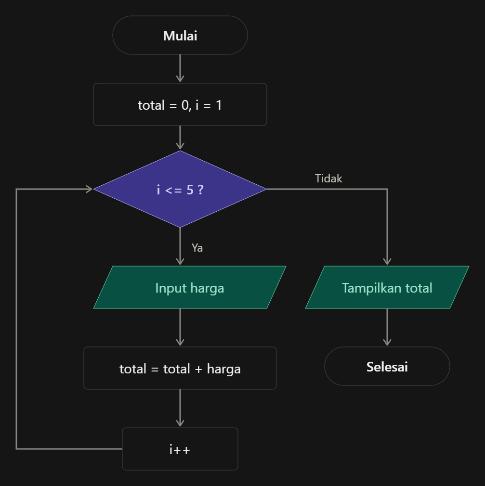
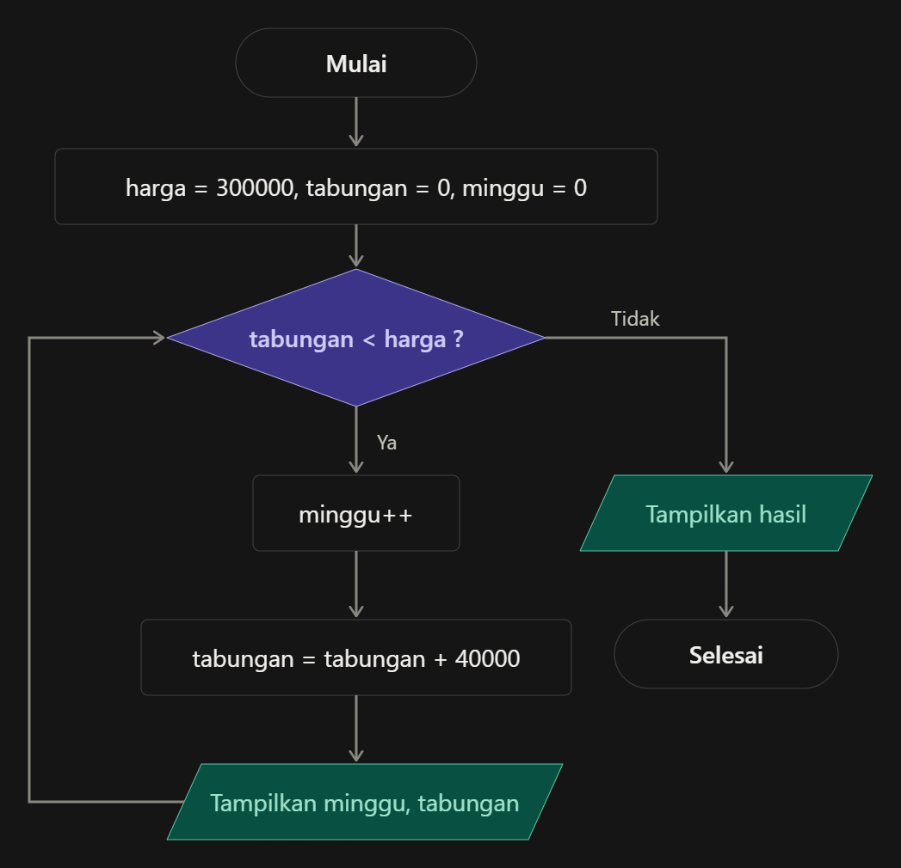
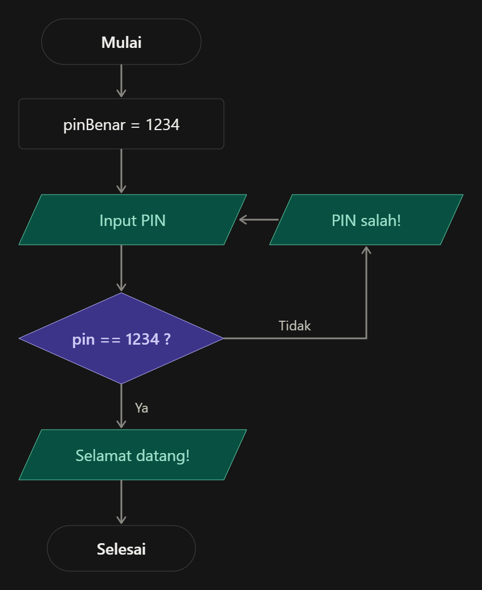
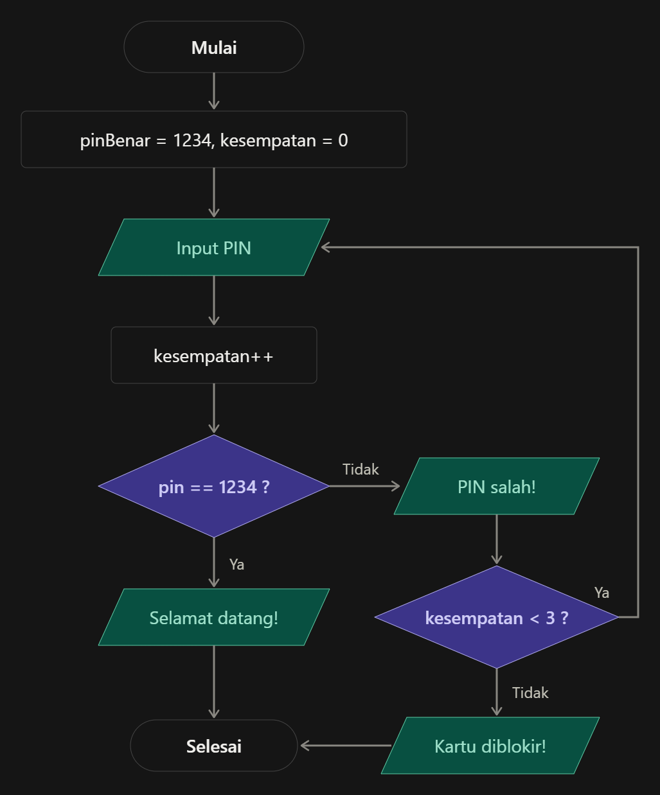

Soal 1: Toko Kue Bu Rina 

Bu Rina punya toko kue kecil di dekat kampus. Tokonya punya aturan unik: setiap pelanggan selalu membeli tepat 5 kue, tidak lebih dan tidak kurang. Karena harga kuenya berbeda-beda, Bu Rina sering salah hitung saat menjumlahkan. Ia meminta kamu membuat program kasir yang menanyakan harga setiap kue satu per satu, lalu menampilkan total yang harus dibayar.

 Jawaban

Loop yang cocok: for, karena jumlah ulangannya sudah pasti (5 kali).

java
import java.util.Scanner;

public class TokoKue {
    public static void main(String[] args) {
        Scanner sc = new Scanner(System.in);
        int total = 0;

        for (int i = 1; i <= 5; i++) {
            System.out.print("Harga kue ke-" + i + ": ");
            int harga = sc.nextInt();
            total = total + harga;
        }

        System.out.println("Total belanja: " + total);
    }
}

Penjelasan:

total = 0 artinya kita siapkan “keranjang” kosong dulu untuk menampung jumlah.
Setiap putaran, harga yang diketik dimasukkan ke keranjang: total = total + harga.
Setelah 5 kali, loop berhenti dan total ditampilkan.
Soal 2: Celengan Andi 

Andi melihat sepatu impiannya di toko seharga Rp 300.000. Sayangnya uangnya belum cukup. Ia memutuskan menabung Rp 40.000 setiap minggu di celengan. Andi penasaran, berapa minggu ia harus menabung sampai uangnya cukup? Buat program yang menampilkan isi celengan setiap minggu dan berhenti saat uangnya sudah cukup. Ingat, kamu tidak boleh menghitung sendiri jumlah minggunya, biarkan program yang mencarinya.

 Jawaban

Loop yang cocok: while, karena kita belum tahu berapa minggu yang dibutuhkan. Yang kita tahu hanya syaratnya: “selama tabungan belum cukup, terus menabung.”

java
public class CelenganAndi {
    public static void main(String[] args) {
        int hargaSepatu = 300000;
        int tabungan = 0;
        int minggu = 0;

        while (tabungan < hargaSepatu) {
            minggu++;
            tabungan = tabungan + 40000;
            System.out.println("Minggu ke-" + minggu + ": tabungan " + tabungan);
        }

        System.out.println("Tabungan cukup! Butuh " + minggu + " minggu.");
    }
}

Output:

Minggu ke-1: tabungan 40000
Minggu ke-2: tabungan 80000
Minggu ke-3: tabungan 120000
Minggu ke-4: tabungan 160000
Minggu ke-5: tabungan 200000
Minggu ke-6: tabungan 240000
Minggu ke-7: tabungan 280000
Minggu ke-8: tabungan 320000
Tabungan cukup! Butuh 8 minggu.

Penjelasan:

Syaratnya tabungan < hargaSepatu, artinya “selama uang masih kurang”.
Di minggu ke-7, tabungan baru 280.000 (masih kurang), jadi loop lanjut.
Di minggu ke-8, tabungan jadi 320.000. Saat dicek lagi, 320.000 tidak lebih kecil dari 300.000, jadi loop berhenti.
Soal 3: ATM Kampus 

Di kampus ada mesin ATM baru. Setiap kali seseorang memasukkan kartu, ATM pasti langsung meminta PIN. PIN yang benar adalah 1234. Kalau PIN yang dimasukkan salah, ATM menampilkan “PIN salah!” dan meminta PIN lagi. Ini terus berulang sampai PIN-nya benar. Kalau sudah benar, ATM menampilkan “Selamat datang!”.

 Jawaban

Loop yang cocok: do-while, karena ATM pasti minta PIN minimal 1 kali, baru setelah itu dicek benar atau salah.

java
import java.util.Scanner;

public class ATMKampus {
    public static void main(String[] args) {
        Scanner sc = new Scanner(System.in);
        int pinBenar = 1234;
        int pin;

        do {
            System.out.print("Masukkan PIN: ");
            pin = sc.nextInt();

            if (pin != pinBenar) {
                System.out.println("PIN salah!");
            }
        } while (pin != pinBenar);

        System.out.println("Selamat datang!");
    }
}

Penjelasan:

!= artinya “tidak sama dengan”.
Bagian do { ... } dijalankan dulu: minta PIN, lalu cek kalau salah tampilkan pesan.
while (pin != pinBenar) artinya “ulang lagi selama PIN-nya masih salah”.
Kalau pakai while biasa, kita harus cek PIN sebelum PIN-nya diminta, jadi kurang cocok.

 ATM dengan 3 kesempatan

Kalau PIN salah 3 kali, kartu diblokir.

java
import java.util.Scanner;

public class ATMBlokir {
    public static void main(String[] args) {
        Scanner sc = new Scanner(System.in);
        int pinBenar = 1234;
        int pin;
        int kesempatan = 0;

        do {
            System.out.print("Masukkan PIN: ");
            pin = sc.nextInt();
            kesempatan++;

            if (pin != pinBenar) {
                System.out.println("PIN salah!");
            }
        } while (pin != pinBenar && kesempatan < 3);

        if (pin == pinBenar) {
            System.out.println("Selamat datang!");
        } else {
            System.out.println("Kartu diblokir!");
        }
    }
}

Penjelasan:

kesempatan menghitung sudah berapa kali mencoba.
&& artinya “dan”. Jadi loop diulang hanya kalau PIN masih salah DAN kesempatan masih kurang dari 3. Setelah loop selesai, kita cek: berhenti karena PIN benar, atau karena kesempatan habis?
Cara gampang memilih loop 
Tahu pasti berapa kali? → for
Tidak tahu berapa kali, cek dulu baru jalan? → while
Harus jalan dulu minimal sekali? → do-while

soal 1

Soal 2: Celengan Andi (while). Bentuknya mirip dengan for, karena sama-sama cek syarat di awal. Bedanya, kita tidak tahu berapa kali akan berputar.

Soal 3: ATM Kampus (do-while). Perhatikan bedanya: program langsung minta PIN dulu, baru dicek di belah ketupat. Kalau salah, panah kembali ke input PIN.

Cara cepat membedakannya dari flowchart:

for dan while: belah ketupat ada sebelum proses. Kalau syaratnya salah dari awal, proses tidak dijalankan sama sekali.
do-while: input/proses ada sebelum belah ketupat. Jadi proses pasti jalan minimal sekali.

 flowchart bonus ATM yang dibatasi 3 kesempatan.

Loop	    Cek syarat kapan?	    Cocok untuk
for	        di awal	jumlah          ulangan sudah pasti
while	    di awal	jumlah          ulangan belum pasti
do-while	di akhir	            harus jalan minimal 1 kali